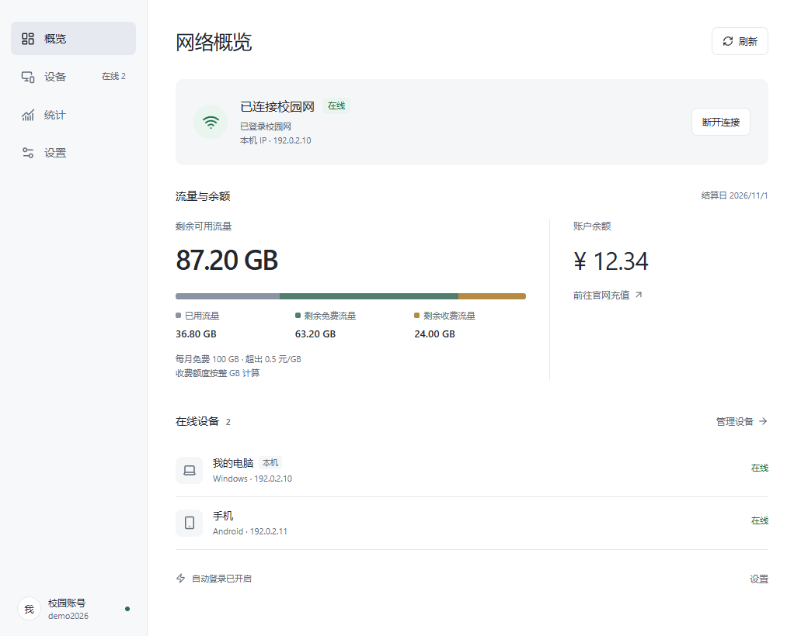
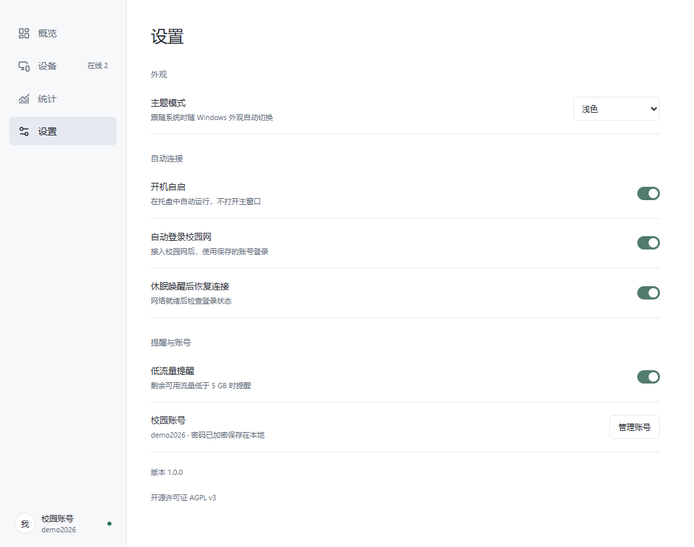
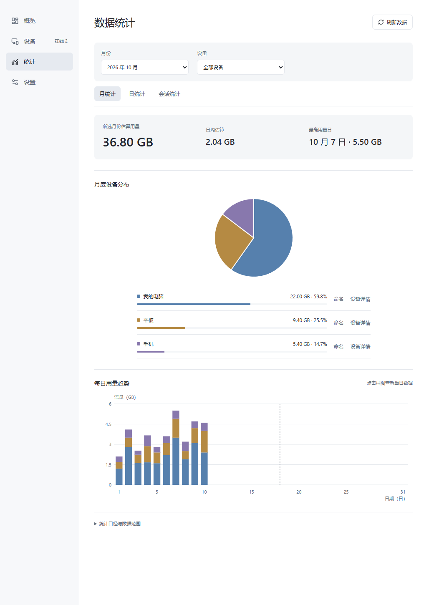
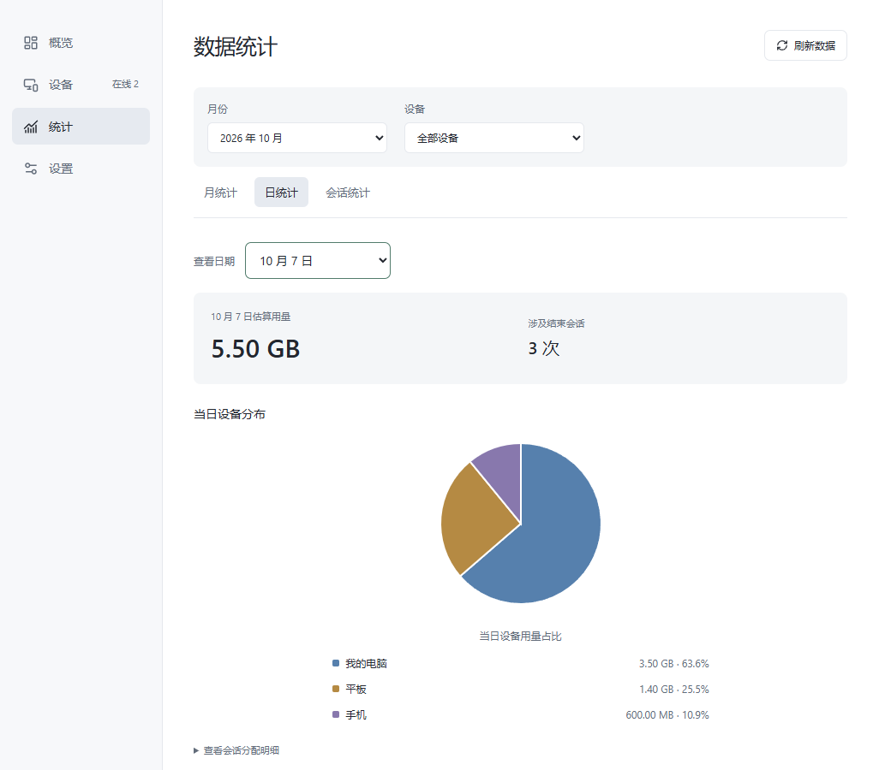

  

<h1 align="center">人大校园网助手</h1>

RUC Web Helper

自动登录 RUC-Web，查看每天、每台设备的校园网用量。

支持 **Windows · 中国人民大学校园网**，提供自动登录、多账号管理、设备管理和流量统计。适用于 [go.ruc.edu.cn](https://go.ruc.edu.cn/)，是个人开发的非官方开源工具。

## 自动登录

添加学工号和数智人大密码后，助手可在启动及休眠唤醒时自动登录。「开机自启」默认开启，登录 Windows 后即可在托盘中运行，可在设置中关闭。

## 多账号管理

可添加多个校园网账号，支持一键切换。密码加密保存在本地。

## 流量统计

首页显示剩余流量和余额，并区分已用流量、剩余免费流量与剩余收费流量，支持低流量提醒。

### 月统计

查看本月估算用量、日均用量、最高用量日，以及各设备的流量占比和每日趋势。可按设备筛选。

### 日统计

点击月统计柱状图或选择日期，查看当天用量与设备占比；会话统计可进一步查看上网时段和用量。

## 开始使用

从 [Releases（发行版）](https://github.com/FengNKT/ruc-web-helper/releases) 下载单个 EXE，无需安装。

1. 将 EXE 放到长期存放的位置，双击运行。
2. 按引导添加学工号和数智人大密码。
3. 「开机自启」默认开启，不需要时可在设置中关闭。

账号、设置和缓存保存在 `%LOCALAPPDATA%\cn.ruc.webhelper`，移动或替换 EXE 不影响数据；旧版同目录数据会自动迁移。程序需要 WebView2 Runtime。更多操作见 [使用指南](docs/usage.md)。

## 反馈与参与

欢迎在 [Issues](https://github.com/FengNKT/ruc-web-helper/issues) 反馈问题，请附操作步骤和错误提示，遮住截图中的学工号、IP、MAC 等个人信息，不要公开密码或账号文件。

构建和开发说明见 [开发指南](docs/development.md)。

## 使用与隐私声明

本项目为个人开发的非官方工具，与中国人民大学及校园网认证系统供应商无隶属或背书关系。请仅在本人账号或合法授权范围内使用，并遵守学校的账号与网络使用规则；不得用于越权访问、获取他人信息、规避认证或计费限制、干扰网络服务。

账号密码使用 Windows 当前用户范围的 DPAPI 加密保存在本机，并在认证时用于生成向学校服务提交的认证请求。设备档案等数据保存在本地；删除本机凭据不会自动清除设备档案、恢复备份或旧版数据副本。软件也可沿用本机已有的校园网认证会话查询信息，请勿在未经授权的他人会话中使用。

软件默认向 GitHub 检查更新，可在设置中关闭；更新请求不主动附带校园账号、密码或上网明细，但对端可能接触请求来源 IP、软件版本等网络信息。流量统计包含估算，实际用量、余额及计费以学校系统为准；学校接口调整可能影响功能。

详细的数据处理范围、自动登录行为、关闭与清理方法见[使用与隐私说明](docs/privacy.md)。本声明及开源许可证不排除依法不得排除或限制的责任。

## 开源许可证

[GNU AGPL v3](LICENSE)。
