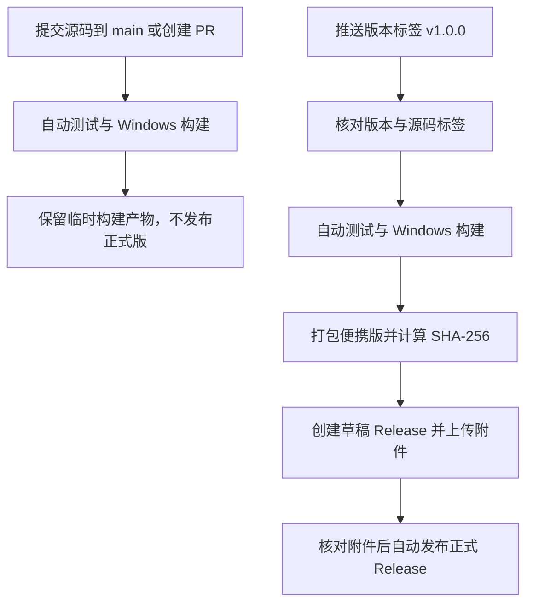

# 源码与 GitHub Release 发布流程

首个正式版本为 **1.0.0**，对应标签 **v1.0.0**。项目以本目录 `ruc-web-helper/` 为仓库根目录，主分支为 `main`。

目标仓库：[FengNKT/ruc-web-helper](https://github.com/FengNKT/ruc-web-helper)。[Actions](https://github.com/FengNKT/ruc-web-helper/actions) 用于查看自动构建状态，[Releases](https://github.com/FengNKT/ruc-web-helper/releases) 用于下载正式版本。

## 源码与软件分别放在哪里

- GitHub 的 Code 页面保存源码、README、文档、许可证、测试和构建工作流。
- GitHub 的 Releases 页面保存可运行的软件。学生下载便携 ZIP，解压运行即可。
- 每个正式版本有对应 tag，Release 的 Source code 下载项对应该 tag 的源码。
- EXE、ZIP、个人运行数据、依赖及构建缓存不提交到源码仓库。

`package.json` 的 `private: true` 仅防止误发布到 npm，不影响 GitHub 开源。

## 已配置的工作流



| 文件 | 作用 |
| --- | --- |
| `.github/workflows/ci.yml` | `main` 提交、PR 或手动运行时进行验证，不创建 Release |
| `.github/workflows/build.yml` | CI 与发布共用的 Windows x64 测试、编译、打包流程 |
| `.github/workflows/release.yml` | 推送版本 tag 后自动发布，也可填写已有 tag 手动重试 |
| `scripts/version.cjs` | 同步和核对各处版本，检查 tag 与发布说明 |
| `scripts/package-release.ps1` | 仅从指定构建产物和文档制作干净发布包 |
| `docs/releases/<版本>.md` | 面向用户的该版本发布说明 |

构建环境使用 GitHub 托管 `windows-2022`、Node.js 22.14.0、Rust 1.92.0、MSVC x64。使用 npm/Cargo 锁文件，依次执行 JavaScript、界面、Rust 检查，再构建便携 EXE。界面检查使用预装 Edge 和虚构后端，不进行真实校园网登录或断网操作。

GitHub 官方 Actions 固定到已核对的提交，并配置 Dependabot 按月提出组件更新。验证、构建任务只有源码读取权限；只有最后发布任务拥有 `contents: write`。使用 GitHub 自动提供的 `GITHUB_TOKEN`，不需要额外创建个人 token 或把凭据放入源码。

临时 Actions 产物保留 14 天；正式 Release 附件不使用这一过期策略。所有检查都通过才会进入发布步骤。上传中断时保留草稿，重试可继续；已经公开的同名 Release 不覆盖，修复应发布新的版本。

## 首次把源码放入已创建的仓库

首次发布需要在项目根目录初始化 Git。目标仓库为公开仓库，2026 年 10 月 11 日首次发布前检查时远程尚无分支或提交；实际首次推送前应确认远程没有新增内容。

如果远程仓库为空，可在项目根目录运行：

```powershell
git init -b main
git add .
git diff --cached --name-only
git commit -m "Prepare RUC Web Helper 1.0.0"
git remote add origin https://github.com/FengNKT/ruc-web-helper.git
git push -u origin main
```

提交前查看文件清单，确认不含本地 `交付/`、`account.enc`、设置、设备档案、WebView2 缓存、调研原始数据或测试截图。不要使用 `git add -f` 绕过忽略规则。

如果远程已有提交，应先克隆远程仓库，再将本项目的公开文件合并进去，保留远程历史；不要直接强制推送覆盖远程。上级目录中的校园网调研材料不属于本项目。

首次推送后，在 GitHub 的 Actions 页面确认 CI 成功。建议保护 `main`，要求 PR 检查通过，并保护 `v*` 标签，限制标签创建者以及禁止随意移动、删除已经发布的标签。

## 发布 1.0.0

本次已经将 npm 清单与锁文件、Cargo 清单与锁文件、Tauri 配置的六个版本字段统一为 1.0.0，并提供 `docs/releases/1.0.0.md`。

源码提交到 `main` 且 CI 通过后，在对应提交创建标签：

```powershell
git switch main
git pull --ff-only
npm run version:check
git tag -a v1.0.0 -m "RUC Web Helper 1.0.0"
git push origin v1.0.0
```

**推送版本标签就是正式发布动作。** 工作流会从该 tag 取源码，确认该提交已在 `main` 历史中，校验 tag、各版本字段与发布说明后，重新构建和发布。无需提前在 GitHub 页面手动创建同名正式 Release。

首发附件如下：

```text
ruc-web-helper_1.0.0_windows-x86_64_portable.zip   学生首次使用下载此文件
ruc-web-helper_1.0.0_windows-x86_64.exe            手动替换程序使用
SHA256SUMS.txt                                   上述两个文件的摘要
```

ZIP 包内只包含：

```text
人大校园网助手.exe
LICENSE
使用说明.md
statistics.md
SHA256.txt
```

本项目不生成安装包。当前未进行 Windows Authenticode 代码签名，SHA-256 文件只用于核对下载完整性，不能代替签名身份验证。发布包来自干净的 CI 构建，不能打包日常使用的 `交付/` 目录。

## 下次发布

以 1.0.1 为例：

1. 修改功能并完成检查。
2. 运行 `npm run version:set -- 1.0.1`，一次同步全部六个版本字段。
3. 编写 `docs/releases/1.0.1.md`，说明用户可见变化与必要注意事项。
4. 将修改提交到 `main`，等待 CI 通过。
5. 创建并推送 `v1.0.1` 标签，自动生成新的 Release。

不要移动已发布的标签。构建失败时在 Actions 查看失败原因；仅网络或上传问题可重跑原任务。源代码需要修改时，应使用新提交和新版本，不让一个版本号对应两套源码或程序。

## 本地验证打包

```powershell
npm ci
npm run version:check
npm test
npm run test:ui
npm run test:rust
npm run desktop:build:x64
npm run release:package
```

本地产物在已忽略的 `release/<版本>/`。打包脚本拒绝覆盖已有同版本输出，优先在干净工作副本中运行。工作流发布前会再次核对下载到发布任务中的文件摘要与标签提交。

## 与应用内更新的关系

**1.0.0 的 GitHub 发布流水线不代表客户端已有自动更新能力。** 当前客户端仍需手动下载替换。

后续按 [自动更新设计](updating.md) 实现客户端、生成更新签名密钥后，再扩展这条流水线，增加 `update.json` 与 `update.json.sig`，并在发布前完成签名验证。不要现在发布无签名的伪更新清单，也不要将独立 EXE 当作安装包交给 Tauri 官方 updater。

AGPL v3 完整文本随源码和便携包提供；第三方依赖遵循各自许可证，公开发布前应完成相应许可与必要通知核查。

参考：[GitHub 工作流自动凭据](https://docs.github.com/en/actions/tutorials/authenticate-with-github_token)、[GitHub CLI 发布命令](https://cli.github.com/manual/gh_release_create)。

## 1.1.0 起的签名更新附件

发布任务在上传前调用 `scripts/sign-update.cjs`，使用仓库 Secret `UPDATE_SIGNING_KEY` 生成 `update.json` 和 `update.json.sig`，并更新 SHA256SUMS。发布附件数因此为五个。构建与普通 PR 不接触签名密钥，只有正式发布步骤使用它。

该 Secret 已为本仓库配置。客户端公钥位于 `src-tauri/update-public-key.txt`，本地私钥备份位于忽略目录 `.local/update-signing.key`；不要提交或公开私钥，不要随意重置密钥。签名脚本会核对公私钥是否配对，缺少密钥时停止发布。

本地打包后可运行：

```powershell
node scripts/sign-update.cjs release/1.1.0 .local/update-signing.key
```

客户端只安装正式发布且签名有效的后续版本。详细实现与限制见[自动更新说明](updating.md)。
